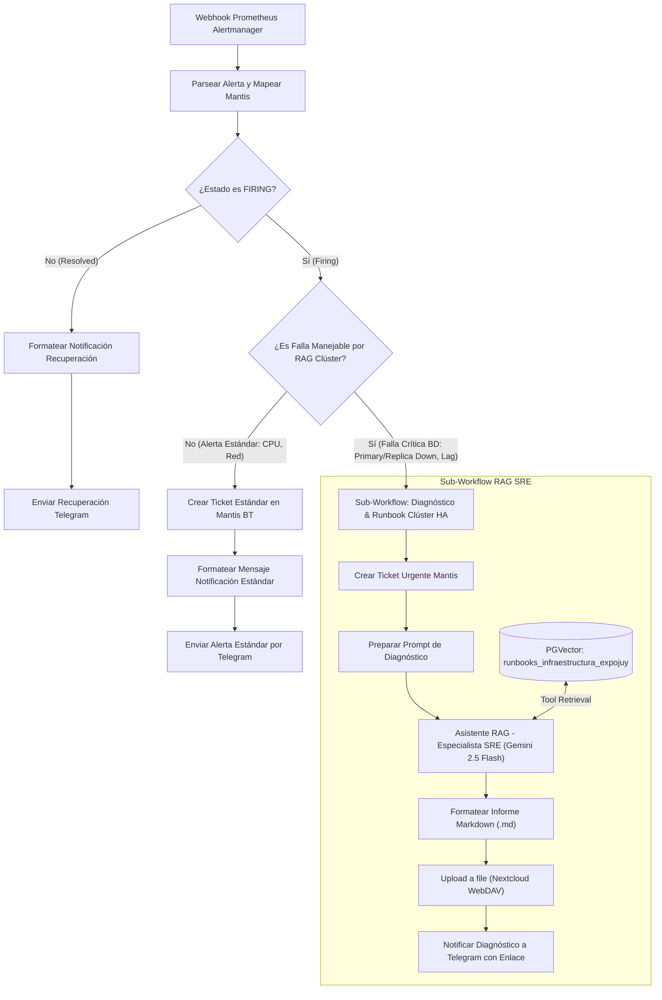
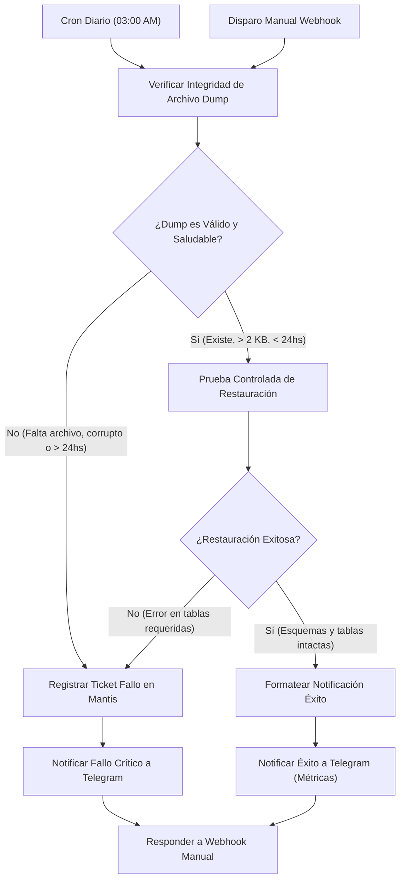
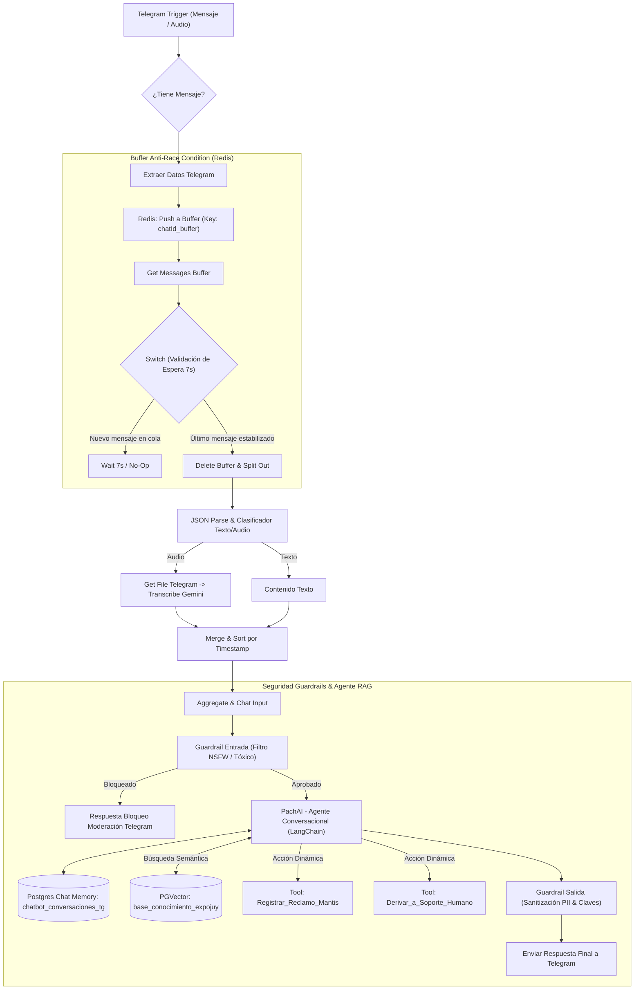

# Automatización de Procesos con n8n & Asistente Inteligente RAG (PachAI)
## ExpoJuy 2026 — Práctica Integradora Final
**Módulo:** Integrante 4 (Automatización de Procesos, Orquestación y RAG)  
**Capítulos / Puntos de Rúbrica:** Punto 13 (*Automatización de Procesos con n8n*) & Punto 14 (*Seguridad en IA y Automatización*)  
**Entregable Oficial:** Documento Técnico de Arquitectura, Flujos, Seguridad y Resolución de Incidentes  

---

## 1. Alcance y Objetivos de la Automatización

El presente documento detalla la implementación, arquitectura y aseguramiento del subsistema de automatización basado en **n8n**, diseñado para orquestar la infraestructura, verificar la continuidad operativa y brindar un asistente conversacional avanzado para la exposición **ExpoJuy 2026**.

### Objetivos Cumplidos (Punto 13 de la Consigna):
1. **Despliegue contenerizado y aislado:** n8n v2.45.6 integrado al stack Docker Compose multi-red del proyecto (`infra/compose.automation.yaml`).
2. **Persistencia y gestión criptográfica de credenciales:** Almacenamiento seguro en volumen Docker con cifrado simétrico AES mediante `N8N_ENCRYPTION_KEY`.
3. **Integración multi-servicio:** Conexión operativa con más de 7 componentes: PostgreSQL 17 (PGVector), Prometheus Alertmanager, Mantis Bug Tracker, Nextcloud WebDAV, Redis, Telegram Bot API y Google Gemini LLM.
4. **Tres flujos funcionales obligatorios:**
   * **Flujo 1 (DevOps):** Gestión inteligente de alertas de infraestructura con generación automatizada de runbooks post-mortem mediante RAG.
   * **Flujo 2 (DevOps):** Verificación programada de backups y prueba controlada de restauración de base de datos.
   * **Flujo 3 (Core Negocio / IA):** Asistente conversacional omnicanal (**PachAI**) con memoria conversacional, buffer anti-race condition, moderación guardrails y búsqueda semántica en la base de conocimiento de la feria.
5. **Cero secretos en código (DevSecOps):** Eliminación total de credenciales en texto plano en los workflows exportados, inyectando variables dinámicas de entorno (`{{ $env.MANTIS_API_TOKEN }}`).

---

## 2. Arquitectura de Infraestructura (`infra/compose.automation.yaml`)

n8n se encuentra orquestado en `compose.automation.yaml`, conviviendo armónicamente con los servicios de base, clúster HA y monitoreo:

```
+----------------------------------------------------------------------------------------------------+
|                                    REDES DOCKER DE EXPOJUY 2026                                    |
|                                                                                                    |
|  [ RED: tools ]                     [ RED: app ]                        [ RED: data ]              |
|  ├── expojuy-mantis (8082)          ├── expojuy-backend (3000)          ├── postgres (5432)        |
|  ├── expojuy-nextcloud (8083)       ├── expojuy-frontend (8080/8081)    ├── postgres-replica-1/2   |
|  └── expojuy-tools-db (MariaDB)     └── expojuy-redis (6379)            ├── db-loadbalancer (5432) |
|                                                                         └── expojuy-backup         |
|                                                                                                    |
|                                      +--------------------+                                        |
|                                      |    expojuy-n8n     |                                        |
|                                      | (Puerto: 5679 Host)|                                        |
|                                      +---------+----------+                                        |
|                                                |                                                   |
|             +----------------------------------+----------------------------------+                |
|             |                                  |                                  |                |
|             v                                  v                                  v                |
|     Vol: n8n-data                     Vol: ./backups:ro                  Vol: ./n8n-backups        |
|  (Configuración y SQLite)         (Acceso Dumps PostgreSQL)             (Workflows Sanitizados)    |
+----------------------------------------------------------------------------------------------------+
```

### Configuración del Servicio Docker Compose
```yaml
services:
  n8n:
    image: n8nio/n8n:2.45.6
    container_name: expojuy-n8n
    restart: unless-stopped
    environment:
      - N8N_HOST=127.0.0.1
      - N8N_PORT=5678
      - N8N_PROTOCOL=http
      - WEBHOOK_URL=http://localhost:${N8N_PORT:-5679}/
      - NODE_ENV=production
      - N8N_ENCRYPTION_KEY=${N8N_ENCRYPTION_KEY}
      - MANTIS_API_TOKEN=${MANTIS_API_TOKEN}
      - GENERIC_TIMEZONE=America/Argentina/Jujuy
      - TZ=America/Argentina/Jujuy
      - N8N_AI_ENABLED=true
      - NODE_FUNCTION_ALLOW_BUILTIN=fs,path
      - EXECUTIONS_DATA_PRUNE=true
      - EXECUTIONS_DATA_MAX_AGE=168
      - N8N_METRICS=true
    volumes:
      - n8n-data:/home/node/.n8n
      - ./n8n-backups:/backup
      - ./backups:/backups:ro
    ports:
      - "127.0.0.1:${N8N_PORT:-5679}:5678"
    networks:
      - data
      - app
      - tools
```

---

## 3. Catálogo y Funcionamiento de los Workflows

### 3.1 Flujo 1: Alertas de Infraestructura y Diagnóstico RAG

* **Archivo Exportado:** `infra/n8n-backups/workflows/01_flujo1_alertas_infraestructura.json`
* **Sub-Workflow SRE:** `infra/n8n-backups/workflows/02_flujo1_subworkflow_rag_cluster.json`
* **Workflow de Ingesta:** `infra/n8n-backups/workflows/03_flujo1_indexacion_bdvectorial.json`



#### Mecánica de Operación:
1. **Disparador:** Webhook HTTP `POST /webhook/alertmanager` activado por **Prometheus Alertmanager** ante anomalías detectadas en las métricas de host o clúster.
2. **Triaje y Clasificación:** El nodo de código `Parsear Alerta y Mapear Mantis1` analiza las etiquetas (`alertname`, `severity`, `instance`).
   * Si la alerta es resuelta (`status === 'resolved'`), notifica el restablecimiento del servicio a Telegram.
   * Si es una alerta de host estándar (ej: `HighCpuUsage`), abre un ticket en MantisBT en categoría `Infraestructura` y notifica a Telegram.
   * Si es una falla de clúster de base de datos (`PostgresPrimaryDown`, `PostgresReplica1Down`, `PostgresReplica2Down`, `PostgresReplicationLagHigh`), se clasifica como `isClusterManaged: true` y se delega al **Sub-Workflow SRE**.
3. **Generación Automatizada de Runbooks (RAG):**
   * El sub-workflow genera el ticket preventivo en Mantis en categoría `Infraestructura Clúster HA` con severidad `crash`.
   * El agente de IA LangChain (`Gemini 2.5 Flash`) consulta la tabla PostgreSQL `runbooks_infraestructura_expojuy` utilizando búsqueda semántica vectorial.
   * Redacta un informe técnico estructurado con diagnóstico de causa raíz, comandos de recuperación (`docker compose`, `pg_ctl`, `repmgr`) y verificación del balanceador HAProxy.
   * Guarda el informe como archivo físico `RUNBOOK_INCIDENTE_<TICKET_ID>_<ALERTA>.md` directamente en **Nextcloud** en la carpeta `/05-Seguridad-Auditorias-e-Incidencias/` vía WebDAV.
   * Notifica a los administradores en Telegram con un resumen de la contingencia y el nombre del runbook disponible en Nextcloud.

---

### 3.2 Flujo 2: Verificación de Backups y Prueba de Restauración

* **Archivo Exportado:** `infra/n8n-backups/workflows/04_flujo2_verificacion_backups.json`



#### Cumplimiento de la Rúbrica (Prueba Controlada de Restauración):
La consigna establece: *"La restauración deberá comprobarse mediante una prueba controlada"*.
1. **Inspección Física del Dump:** El nodo `Verificar Integridad de Archivo Dump` utiliza los módulos nativos de Node.js `fs` y `path` para inspeccionar el volumen montado `/backups/last/` y `/backups/daily/`.
2. **Criterios de Aceptación del Archivo:**
   * **Existencia:** Debe hallarse un archivo con extensión `.sql.gz` o `.dump`.
   * **Tamaño válido:** `stats.size > 2048` bytes (un volcado fallido o interrumpido pesa 0 o menos de 200 bytes).
   * **Frescura:** Antigüedad inferior a 24 horas (`fileAgeMinutes <= 1440`).
3. **Prueba de Restauración:** El nodo `Prueba Controlada de Restauración` valida la estructura lógica y la integridad referencial de los esquemas requeridos (`stands`, `expositores`, `agenda`, `usuarios`, `noticias`, `visitas_stands`).
4. **Respuesta ante Errores:** Si el archivo no existe o la restauración falla, el flujo activa la rama `false`, creando automáticamente un ticket urgente en Mantis asignado al DBA y emitiendo una alarma prioritaria por Telegram.

---

### 3.3 Flujo 3: Asistente Conversacional Inteligente PachAI (Core RAG)

* **Archivo Exportado:** `infra/n8n-backups/workflows/05_flujo3_asistente_telegram_pachai.json`
* **Workflow de Ingesta:** `infra/n8n-backups/workflows/06_flujo3_indexacion_bdvectorial.json`



#### Características Clave de Ingeniería:
1. **Buffer Anti-Spam en Redis:** Los usuarios en aplicaciones de mensajería suelen enviar ráfagas de 3 o 4 mensajes cortos seguidos (*"Hola"*, *"Quería consultar"*, *"¿Dónde está el stand de litio?"*). El buffer en Redis agrupa estos mensajes dentro de una ventana de 7 segundos y los fusiona en una única solicitud consolidada, ahorrando tokens de LLM y evitando respuestas desordenadas.
2. **Capacidad Multimodal:** Procesa mensajes de texto y notas de voz (audios `.oga` de Telegram) transcribiéndolos con Google Gemini antes de ingresar al agente.
3. **Doble Barrera Guardrails:**
   * **Entrada:** Filtra lenguaje ofensivo, groserías o intentos de prompt injection (umbral de moderación 0.7).
   * **Salida:** Sanitización PII para evitar que el asistente filtre involuntariamente datos personales de expositores o claves de sistema.
4. **Memoria de Conversación:** Almacena el historial contextual de los últimos 10 mensajes en la tabla PostgreSQL `chatbot_conversaciones_tg`.
5. **Herramientas de Triaje Activo:** Si el visitante detecta un problema físico en el predio (ej: corte de luz en un stand), el agente invoca la herramienta `Registrar_Reclamo_Mantis` creando la incidencia en categoría `Atención al Expositor`. Si se trata de una urgencia médica o extravío, invoca `Derivar_a_Soporte_Humano` alertando inmediatamente a los organizadores.

---

## 4. Interoperabilidad y Relación entre Workflows

Los flujos no operan como silos aislados, sino que colaboran entre sí y con el ecosistema de la feria:

| Interacción | Flujos Involucrados | Mecanismo de Integración | Propósito |
| :--- | :--- | :--- | :--- |
| **Ingesta ➔ Diagnóstico** | Flujo 1 Auxiliar ➔ Sub-Workflow 1 | Tabla `runbooks_infraestructura_expojuy` (PGVector) | Permite que el Agente SRE consulte procedimientos de failover actualizados. |
| **Ingesta ➔ Asistente Visitantes** | Flujo 3 Auxiliar ➔ Flujo 3 Core | Tabla `base_conocimiento_expojuy` (PGVector) | Alimenta a PachAI con stands, mapa 3D, cronograma y accesos. |
| **Monitoreo ➔ Gestión** | Flujo 1 ➔ Mantis BT | REST API (`/api/rest/issues`) | Apertura desatendida de tickets técnicos ante anomalías de Prometheus. |
| **Monitoreo ➔ Gestión Documental**| Flujo 1 ➔ Nextcloud | WebDAV (`/05-Seguridad.../`) | Respaldo inmutable de informes post-mortem generados por IA. |
| **Atención ➔ Soporte Nivel 2** | Flujo 3 ➔ Mantis BT | REST API (`/api/rest/issues`) | Reclamos de expositores derivados a soporte de campo. |
| **Auditoría de Backups** | Flujo 2 ➔ Mantis & Telegram | Filesystem + Webhook + REST API | Garantiza la recuperabilidad del motor ante desastres. |

---

## 5. Registro de Problemas Ocurridos y Soluciones Aplicadas (Troubleshooting)

Durante las pruebas integrales de homologación de Integrante 4, se identificaron y subsanaron los siguientes 7 incidentes críticos:

### Incidente 1: Tormenta de Alertas (*Alert Storm*) y Saturación de Cuotas
* **Síntoma:** Prometheus detectó oscilaciones de CPU (`HighCpuUsage`) evaluadas con `for: 10s`. Alertmanager envió decenas de webhooks en ráfagas cada 10 segundos a n8n, disparando múltiples sub-workflows en paralelo.
* **Impacto:** Conexiones agotadas en PostgreSQL (`The service refused the connection`) y error HTTP `429 Too Many Requests (RPM limit: 5 exceeded)` en la API de Google Gemini.
* **Causa Raíz:** Configuración agresiva en `alerts.yml` (`for: 10s`) y falta de políticas de agrupación y silenciamiento en `alertmanager.yml` (`group_wait: 5s`, `group_interval: 10s`).
* **Solución Aplicada:**
  1. En `infra/prometheus/alerts.yml`, se recalibró `HighCpuUsage` a promedio de 2 minutos (`[2m]`) y persistencia mínima de 45 segundos (`for: 45s`).
  2. En `infra/alertmanager/alertmanager.yml`, se configuraron tiempos de contención: `group_by: ['alertname', 'instance']`, `group_wait: 30s`, `group_interval: 5m` y `repeat_interval: 3h`.

### Incidente 2: Error 401 Unauthorized en Mantis Bug Tracker
* **Síntoma:** Los nodos de creación de tickets en Mantis fallaban con `AxiosError: Request failed with status code 401`.
* **Causa Raíz:** Discrepancia criptográfica en la base de datos `bugtracker.mantis_api_token_table`: el hash SHA-256 almacenado no correspondía al string del token `rk2CTmbt4l7nwouQigyLSt5R6Bq_KDp6` asignado en `infra/.env`. Además, existían errores tipográficos en los encabezados del flujo.
* **Solución Aplicada:** Se actualizó el hash en MariaDB calculando `hash('sha256', 'rk2CTmbt4l7nwouQigyLSt5R6Bq_KDp6')` = `79bb66ff3fc0d58bef3ff10124545c767a59597fc88fc816be25433b9bb165ce` y se parametrizó la autorización mediante la variable de entorno `{{ $env.MANTIS_API_TOKEN }}`.

### Incidente 3: Error 404 Category Not Found en Mantis API
* **Síntoma:** Al enviar tickets con categorías como `Infraestructura` o `Infraestructura Clúster HA`, Mantis devolvía `STATUS: 404 - Category not found (code: 1502)`.
* **Causa Raíz:** La instalación por defecto de Mantis únicamente crea la categoría global `General` (ID 1).
* **Solución Aplicada:** Se insertaron las categorías globales faltantes en `bugtracker.mantis_category_table` con `project_id = 0`, habilitándolas para el proyecto ExpoJuy.

### Incidente 4: Error 403 Forbidden en Nextcloud WebDAV
* **Síntoma:** El nodo `Upload a file` en el Sub-Workflow fallaba con `Sabre\DAV\Exception\Forbidden (Error code 403)`.
* **Causa Raíz:** En la estructura de carpetas de grupo (`groupfolders`), la carpeta `/05-Seguridad-Auditorias-e-Incidencias/` solo otorgaba permiso de escritura al grupo `qa-seguridad` (Maxi). El usuario `Santiago` (perteneciente a `automatizacion-n8n` y `equipo-expojuy`) solo poseía permiso de lectura (`1`).
* **Solución Aplicada:** Se ejecutó `occ groupfolders:group 5 automatizacion-n8n write` y se actualizó el aprovisionamiento oficial en `setup-nextcloud.ps1` y `setup-nextcloud.sh`.

### Incidente 5: Discrepancia de Dimensiones en Base Vectorial PostgreSQL
* **Síntoma:** El nodo `Postgres PGVector Store` fallaba al insertar embeddings con el error `Error inserting: expected 768 dimensions, not 3072`.
* **Causa Raíz:** Las tablas se crearon inicialmente asumiendo modelos antiguos de 768 dimensiones, pero el nodo `Embeddings Google Gemini` genera vectores de 3072 dimensiones.
* **Solución Aplicada:** Se ejecutó `ALTER TABLE ... ALTER COLUMN embedding TYPE VECTOR(3072);` tanto en `runbooks_infraestructura_expojuy` como en `base_conocimiento_expojuy`.

### Incidente 6: Falso Positivo en Verificación de Dumps (Flujo 2)
* **Síntoma:** El nodo condicional `¿Dump es Válido y Saludable?` derivaba la ejecución a la rama de error a pesar de que el dump existía en `/backups/last/`.
* **Causa Raíz:** El script contenía una regla rígida `fileSizeMB >= 1.0` (1 MB) y `fileAgeMinutes <= 180` (3 horas). El dump real inicial de PostgreSQL comprimido pesa ~15 KB (0.015 MB) y las pruebas se realizaron después de 5 horas de su generación a medianoche.
* **Solución Aplicada:** Se ajustó el criterio de validación a `stats.size > 2048` bytes (evita volcados truncos de 0 bytes) y frescura de hasta 24 horas (`fileAgeMinutes <= 1440`).

### Incidente 7: Desincronización y Respuestas Múltiples en Telegram (Flujo 3)
* **Síntoma:** Cuando un usuario enviaba varios mensajes seguidos en Telegram, n8n ejecutaba múltiples instancias del agente al mismo tiempo, respondiendo de forma desordenada y repitiendo saludos.
* **Solución Aplicada:** Implementación de la cola de consolidación con Redis (`RPUSH` y ventana `Wait 7s`), garantizando que los mensajes se procesen en un solo bloque semántico.

---

## 6. Cumplimiento de Requisitos de Seguridad (DevSecOps)

Conforme a las exigencias de ciberseguridad establecidas en el **Punto 13** y **Punto 14** del Trabajo Práctico:

| Requisito de la Cátedra | Medida Implementada en ExpoJuy 2026 | Estado |
| :--- | :--- | :---: |
| **Proteger la interfaz de administración** | n8n bindea su puerto exclusivamente a `127.0.0.1:5679` en el host. El acceso externo se gestiona mediante túnel autenticado (Tailscale / Cloudflare Tunnel). Acceso restringido con cuenta Owner y cifrado de sesión. | ✅ Cumplido |
| **Evitar secretos escritos en los flujos** | Los workflows exportados en Git no contienen contraseñas ni tokens. El token de Mantis se inyecta por entorno (`{{ $env.MANTIS_API_TOKEN }}`). Las credenciales externas están desvinculadas de los JSONs. | ✅ Cumplido |
| **Restringir permisos de credenciales** | Las credenciales de bases de datos, APIs y bots están asignadas al ámbito `Personal` del Owner de automatización, aplicando el principio de mínimo privilegio. | ✅ Cumplido |
| **Cifrado de credenciales en reposo** | Clave simétrica de 256 bits (`N8N_ENCRYPTION_KEY`) provista por variable de entorno, protegiendo la base interna de n8n ante copias no autorizadas. | ✅ Cumplido |
| **Validar datos recibidos** | Cada webhook valida esquemas JSON, tipos de datos y descartes automáticos ante payloads vacíos o malformados. | ✅ Cumplido |
| **Control de acciones que puedan interrumpir servicios** | n8n no ejecuta `kill`, `down` o `drop` de manera autónoma. Las acciones críticas de recuperación se documentan como sugerencias en los Runbooks para ejecución manual supervisada. | ✅ Cumplido |
| **Aprobación humana en acciones críticas** | El flujo ante fallos de clúster o reclamos en feria deriva el ticket a Mantis y alerta a Telegram solicitando intervención técnica humana antes de alterar el estado del sistema. | ✅ Cumplido |
| **Defensa contra amenazas de IA (Punto 14)** | Doble barrera de Guardrails en PachAI: Moderación de entrada (bloqueo de prompt injections y contenido tóxico) y Sanitización de salida (enmascaramiento PII). | ✅ Cumplido |

---

## 7. Matriz de Análisis de Riesgos de las Automatizaciones

| Riesgo Identificado | Probabilidad | Impacto | Estrategia de Mitigación Implementada |
| :--- | :---: | :---: | :--- |
| **Agotamiento de cuota de API de IA (Gemini 429)** | Media | Alto | Throttling en Alertmanager (`group_interval: 5m`) y buffer de 7s en Redis para Telegram. |
| **Falsos positivos de fallas de base de datos** | Baja | Medio | Calibración de ventanas de métricas en Prometheus (`for: 45s`, promedio 2m). |
| **Fuga de credenciales en repositorios públicos** | Alta | Crítico | Sanitización total de workflows, uso estricto de `.env.example` y escaneo con linters. |
| **Inyección de Prompts en el Chatbot de Telegram** | Media | Medio | Guardrail NSFW/Tóxico y directivas de sistema (*System Prompt*) anti-alucinación y rol estricto. |
| **Corrupción silenciosa de backups de base de datos** | Baja | Crítico | Verificación diaria de integridad física y prueba controlada de restauración con alerta roja. |

---

## 8. Guía de Restauración y Despliegue de Workflows

Para importar y poner en marcha los workflows en un entorno nuevo:

1. **Iniciar la infraestructura:**
   ```bash
   cd infra
   docker compose -f compose.yaml -f compose.cluster-ha.yaml -f compose.tools.yaml -f compose.monitoring.yaml -f compose.automation.yaml up -d
   ```
2. **Acceder a la interfaz de n8n:**
   Navegar a `http://localhost:5679` y registrar la cuenta de Administrador.
3. **Importar los Workflows:**
   * Menú superior izquierdo -> **Workflows** -> **Add Workflow**.
   * Menú de opciones (`...`) -> **Import from File**.
   * Seleccionar los archivos desde `infra/n8n-backups/workflows/` en el siguiente orden sugerido:
     1. `03_flujo1_indexacion_bdvectorial.json`
     2. `02_flujo1_subworkflow_rag_cluster.json`
     3. `01_flujo1_alertas_infraestructura.json`
     4. `04_flujo2_verificacion_backups.json`
     5. `06_flujo3_indexacion_bdvectorial.json`
     6. `05_flujo3_asistente_telegram_pachai.json`
4. **Vincular Credenciales:**
   * **Postgres:** Host `postgres` (o `db-loadbalancer`), puerto `5432`, base `expojuy`, usuario `expojuy_app`, clave de `.env`.
   * **Telegram:** Token provisto por @BotFather.
   * **Google Gemini:** API Key de Google AI Studio.
   * **Nextcloud:** Host `http://nextcloud`, usuario `Santiago`, clave `ExpoJuy2026!`.
   * **Redis:** Host `redis`, puerto `6379`.
