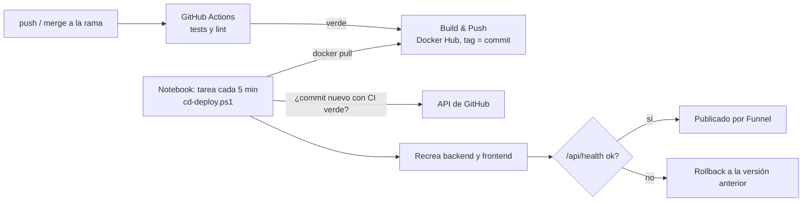

# Despliegue continuo (CD) en la notebook

Cómo un cambio aprobado llega solo a la web publicada, y cómo se vuelve atrás si falla (punto 8).
Responsable: Integrante 1. El CI (tests y build de imágenes) es del Integrante 3.

## 1. Flujo



**Por qué la notebook pregunta (pull) y GitHub no entra (push):** la notebook no tiene puertos de
entrada abiertos (ver [`PUBLICACION_ACCESO.md`](PUBLICACION_ACCESO.md)). Tampoco se usa un
*self-hosted runner*: en un repositorio público, un PR podría ejecutar código en la notebook.
Así, en GitHub no hay ninguna credencial de la notebook.

**Qué evita publicar algo defectuoso:** solo se despliegan commits cuyo CI terminó en verde
(tests, lint y build). Y si la versión nueva no responde, vuelve sola a la anterior.

## 2. Archivos

| Archivo | Qué hace |
|---|---|
| `.github/workflows/ci-cd.yml` | CI: tests, lint y publica `lautarocano/expojuy-backend:<commit>` y `expojuy-frontend:<commit>` en Docker Hub (públicos) |
| `infra/compose.deploy.yaml` | Cambia las imágenes construidas en la notebook por las de Docker Hub |
| `infra/scripts/cd-deploy.ps1` | Consulta GitHub, baja las imágenes, despliega, verifica y hace rollback |
| `infra/cd-deploy.log` | Registro de cada despliegue (local, no se versiona). Es la evidencia |
| `infra/cd-fallidos.txt` | Commits que fallaron; no se reintentan solos (local) |

El script toca **solo backend y frontend** (`--no-deps`) y mantiene el HA: incluye
`compose.cluster-ha.yaml`, así el backend sigue conectado a HAProxy. No necesita tokens: el repo
de GitHub y las imágenes de Docker Hub son públicos.

## 3. Uso manual

Desde la raíz del repo:

```powershell
# Desplegar el último commit con CI verde de develop
powershell -ExecutionPolicy Bypass -File infra/scripts/cd-deploy.ps1 -Rama develop

# Ver qué versión corre (el tag de la imagen es el commit)
docker inspect expojuy-backend-1 expojuy-frontend-1 --format "{{.Name}} {{.Config.Image}}"

# Ver el registro
Get-Content infra/cd-deploy.log -Tail 10
```

Volver a la versión construida en la notebook (sin CD):

```powershell
cd infra
docker compose -f compose.yaml -f compose.cluster-ha.yaml up -d --no-deps backend frontend
```

## 4. Automático (tarea programada de Windows)

Corre el script cada 5 minutos mientras la sesión de Windows esté abierta (Docker Desktop
también la necesita). Correrlo **desde la raíz del repo** (arma la ruta del script solo); cambiar
`develop` por `main` cuando `main` tenga imágenes del CI:

```powershell
$script = (Resolve-Path infra\scripts\cd-deploy.ps1).Path
# conhost --headless: corre sin abrir ninguna ventana (con -WindowStyle Hidden igual aparece un instante)
$accion = New-ScheduledTaskAction -Execute 'conhost.exe' -Argument "--headless powershell.exe -NoProfile -ExecutionPolicy Bypass -File `"$script`" -Rama develop"
$cada5 = New-ScheduledTaskTrigger -Once -At (Get-Date) -RepetitionInterval (New-TimeSpan -Minutes 5)
Register-ScheduledTask -TaskName 'ExpoJuy-CD' -Action $accion -Trigger $cada5 -Description 'Despliegue continuo ExpoJuy 2026'
```

| Para | Comando |
|---|---|
| Ejecutar ahora, sin esperar los 5 minutos | `Start-ScheduledTask -TaskName ExpoJuy-CD` |
| Ver estado y última ejecución (`LastTaskResult` 0 = OK) | `Get-ScheduledTaskInfo -TaskName ExpoJuy-CD` |
| Pausar (por ejemplo, para mantener un rollback manual) | `Disable-ScheduledTask -TaskName ExpoJuy-CD` |
| Reanudar | `Enable-ScheduledTask -TaskName ExpoJuy-CD` |
| Borrar | `Unregister-ScheduledTask -TaskName ExpoJuy-CD -Confirm:$false` |

## 5. Rollback

- **Automático:** si `/api/health` no responde `ok` en 60 s, el script vuelve a las imágenes
  anteriores y anota el commit en `cd-fallidos.txt` para no reintentarlo cada 5 minutos.
- **Manual:** desplegar un commit anterior con `-Tag` (los tags están en Docker Hub). Antes,
  pausar la tarea; si no, a los 5 minutos vuelve a desplegar el último.

  ```powershell
  powershell -ExecutionPolicy Bypass -File infra/scripts/cd-deploy.ps1 -Tag <sha-completo>
  ```

## 6. Evidencias (punto 8)

1. **Commit de prueba:** un cambio visible y chico (por ejemplo, un texto del frontend) por PR a
   la rama que despliega. Captura del CI en verde.
2. **Despliegue:** captura de `cd-deploy.log` con `OK: <commit> desplegado` y de la web pública
   mostrando el cambio.
3. **Fallo y rollback:** desplegar con `-Tag` un commit cuyo backend no arranque (por ejemplo,
   una rama de prueba que rompa `/api/health`), y capturar el `FALLO ... Rollback OK` del registro
   con la web todavía funcionando.

## 7. Estado

| Ítem | Estado |
|---|---|
| CI publica imágenes por commit en Docker Hub | Verificado 16/11/2026 (tags de los últimos commits de `develop`) |
| `cd-deploy.ps1`: despliegue manual | Verificado 16/11/2026: `develop` (`613c9de`) desplegado en 50 s, `/api/health` ok, HA intacto |
| Rollback automático | Pendiente de probar |
| Tarea programada (`-Rama develop`, cada 5 min) | Verificado 16/11/2026: `LastTaskResult` 0 |
| Commit de prueba de punta a punta | Pendiente |

`infra/scripts/deploy-rollback.sh` (bash, para un servidor por SSH) y el job `deploy` comentado
del CI quedan sin uso: este procedimiento los reemplaza. Borrarlos se coordina con el Integrante 3.
