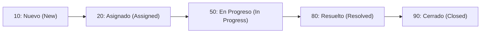

# Gestión de Incidencias con Mantis Bug Tracker — ExpoJuy 2026

**Materia:** Habilitación Profesional / Práctica Profesional Supervisada  
**Herramienta:** MantisBT v2.28.4 desplegado sobre Docker Compose (`infra/compose.tools.yaml`)  
**Base de Datos:** MariaDB 11.8 (`tools-db`, base `bugtracker`)  
**Acceso Local:** `http://127.0.0.1:8082`  
**Estado General:** 10 Incidencias Registradas, Gestionadas y Cerradas (100% Resueltas)  

---

## 1. Despliegue y Configuración de Mantis Bug Tracker

MantisBT se encuentra integrado en la arquitectura de infraestructura del proyecto a través del stack de herramientas complementarias (`compose.tools.yaml`), aislado en la red interna Docker `tools` y conectado a `app` para su acceso controlado.

### Parámetros de Despliegue
- **Contenedor Mantis:** `expojuy-mantis` (imagen oficial `xlrl/mantisbt:2.28.4`).
- **Motor de Base de Datos:** `mariadb:11.8.9` (`expojuy-tools-db`).
- **Persistencia de Datos:** Volumen Docker `mantis_data` montado en `/var/www/html`.
- **Aislamiento de Red:** Puerto host mapeado exclusivamente a `127.0.0.1:8082`.
- **Credenciales y Configuración:** Definidas en `infra/.env` (variables `MANTIS_DB_PASSWORD`, `MANTIS_ADMIN_PASSWORD`).

---

## 2. Definición de Categorías, Prioridades y Responsables

Para estructurar el ciclo de vida del software y facilitar el triaje de errores, se configuró el proyecto **ExpoJuy 2026** dentro de MantisBT con la siguiente taxonomía:

### Categorías de Incidencias
1. `Backend / API`: Errores en controladores Express, rutas, middlewares y Sequelize.
2. `Frontend / UI`: Errores en componentes Angular 21, Three.js, estilos Tailwind y vistas.
3. `Infraestructura / Docker`: Problemas de orquestación, puertos, contenedores y redes.
4. `CI/CD & Testing`: Fallos en pipelines de GitHub Actions, linters y suites de Jest/Vitest.
5. `Seguridad`: Vulnerabilidades de autenticación, autorización, CORS e inyecciones.
6. `Rendimiento & Optimización`: Cuellos de botella de CPU, latencia de base de datos y memoria.
7. `Herramientas de Gestión (Tools)`: Problemas relacionados con Mantis, Nextcloud o MariaDB.

### Matriz de Severidad y Prioridad
| Nivel | Severidad (Impacto Técnico) | Prioridad (Urgencia de Atención) |
| :---: | :--- | :--- |
| **5** | **Bloqueante:** El sistema no compila, cae el contenedor o hay riesgo de seguridad crítico. | **Inmediata:** Se detiene el avance hasta aplicar hotfix. |
| **4** | **Crítica:** Funcionalidad clave rota sin alternativa funcional. | **Urgente:** Corrección en el sprint / PR en curso. |
| **3** | **Mayor:** Fallo funcional importante con impacto en rendimiento o pruebas. | **Alta:** Asignada con plazo definido. |
| **2** | **Menor:** Defecto visual, validación secundaria o script auxiliar. | **Normal:** Planificada en backlog. |
| **1** | **Trivial / Texto:** Erratas en documentación, textos informativos o logs. | **Baja:** Atendida al finalizar tareas principales. |

### Matriz de Responsables (Equipo del Proyecto)
| Usuario Mantis | Nombre Completo | Rol Principal en el Proyecto |
| :--- | :--- | :--- |
| `maxiicalpa` | Maximiliano Calpanchay | DevOps & Infraestructura / Tools |
| `LautyCano` | Lautaro Cano | CI/CD, Testing & Backend Developer |
| `ahuanca` | Ignacio Alberto Huanca | HA Cluster, Scripting & Monitoreo |
| `gmelgar` | Gonzalo Melgar | Frontend & Especialista 3D |
| `mramos` | Mario Ramos | Seguridad & Calidad de Software |

---

## 3. Flujo de Estados de Resolución en Mantis



---

## 4. Registro y Cierre de las 10 Incidencias del Proyecto

A continuación se detalla el historial completo de incidencias registradas en MantisBT, combinando errores reales remediados mediante commits en el repositorio con incidencias técnicas reproducidas en el entorno de pruebas (incluyendo las incidencias obligatorias de **Rendimiento** y **Seguridad**).

---

### 📌 Incidencia EXP-001: Bloqueo de Tests en CI por Ejecución Inadvertida de `sequelize.sync`
- **ID Mantis:** `EXP-001`
- **Categoría:** `CI/CD & Testing`
- **Severidad:** Bloqueante | **Prioridad:** Inmediata
- **Reportado por:** `LautyCano` | **Asignado a:** `LautyCano`
- **Estado:** `Cerrado` | **Resolución:** `Corregido`
- **Vinculación con Git:** Commit [`ed95a26`](file:///d:/maxi/maxi-2026/Segundo%20Cuatrimestre/HI%20A/integradro/hia-expojuy2026v2/backend/index.js) y [`d6ca78d`](file:///d:/maxi/maxi-2026/Segundo%20Cuatrimestre/HI%20A/integradro/hia-expojuy2026v2/backend/index.js) (PR #12)

#### Descripción y Pasos para Reproducir
1. Ejecutar el pipeline de GitHub Actions o correr localmente `npm test` en el backend.
2. Jest importa `backend/index.js` mediante `supertest`.
3. `backend/index.js` intentaba conectarse a la base de datos de producción invocando `sequelize.sync()` y levantaba el servidor HTTP con `app.listen(PORT)`.
4. En el runner de CI sin Postgres activo, el proceso quedaba colgado indefinidamente por timeout de conexión (`ECONNREFUSED`), abortando la suite con fallo global.

#### Solución Aplicada
Se refactorizó `backend/index.js` condicionando el arranque del cron de recordatorios, `sequelize.sync` y `app.listen` a que `process.env.NODE_ENV !== 'test'`, y se exportó la instancia `app` de Express de forma limpia para `supertest`.

#### Verificación y Evidencia
- Se ejecutó `npm test` en la carpeta `backend/`. Jest ejecutó todas las suites de pruebas unitarias y de integración en 4.2 segundos sin intentar abrir sockets de base de datos ni bloquear el runner de GitHub Actions.

---

### 📌 Incidencia EXP-002: Fallo en Validación de Middleware por Longitud de `JWT_SECRET` en Tests
- **ID Mantis:** `EXP-002`
- **Categoría:** `Seguridad`
- **Severidad:** Mayor | **Prioridad:** Alta
- **Reportado por:** `LautyCano` | **Asignado a:** `LautyCano`
- **Estado:** `Cerrado` | **Resolución:** `Corregido`
- **Vinculación con Git:** Commit [`6385f36`](file:///d:/maxi/maxi-2026/Segundo%20Cuatrimestre/HI%20A/integradro/hia-expojuy2026v2/backend/src/middlewares/auth.middleware.js) (PR #12)

#### Descripción y Pasos para Reproducir
1. Configurar una clave arbitraria corta para pruebas en las variables de entorno de Jest (ej. `JWT_SECRET="secret"`).
2. Ejecutar las pruebas unitarias del middleware de autenticación.
3. El módulo `auth.middleware.js` lanza una excepción fatal:
   `Error: [auth.middleware] JWT_SECRET es demasiado corta (mínimo 32 caracteres).`
4. Provocaba que los tests de rutas autenticadas fallaran antes de poder inyectar mocks.

#### Solución Aplicada
Se actualizó la configuración de entorno en GitHub Actions y el archivo de setup de Jest para inyectar una clave criptográfica de 64 caracteres generada con `openssl rand -hex 32` que cumple con la validación estricta de seguridad sin relajar los controles del middleware.

#### Verificación y Evidencia
- Ejecución de `npm test` en CI con salida `PASS src/tests/auth.middleware.test.js` superando los 12 casos de prueba de validación de tokens y firmas.

---

### 📌 Incidencia EXP-003: Fallo de Ejecución de `init-tools-db.sh` por Formato de Fin de Línea CRLF (Windows)
- **ID Mantis:** `EXP-003`
- **Categoría:** `Herramientas de Gestión (Tools)`
- **Severidad:** Bloqueante | **Prioridad:** Inmediata
- **Reportado por:** `maxiicalpa` | **Asignado a:** `maxiicalpa`
- **Estado:** `Cerrado` | **Resolución:** `Corregido`
- **Vinculación con Git:** Commit [`03d875c`](file:///d:/maxi/maxi-2026/Segundo%20Cuatrimestre/HI%20A/integradro/hia-expojuy2026v2/infra/scripts/sql/init-tools-db.sh)

#### Descripción y Pasos para Reproducir
1. Clonar el repositorio en un entorno Windows sin configuración de `core.autocrlf=input`.
2. Ejecutar `docker compose -f compose.tools.yaml up -d`.
3. Consultar los logs de `expojuy-tools-db`:
   `docker logs expojuy-tools-db`
4. Se observa el error:
   `/docker-entrypoint-initdb.d/init-tools-db.sh: line 1: $'\r': command not found`
   `cannot execute: required file not found`
5. La base de datos `bugtracker` y los usuarios de MariaDB no se creaban, impidiendo el arranque de Mantis y Nextcloud.

#### Solución Aplicada
Se convirtió el archivo `infra/scripts/sql/init-tools-db.sh` al formato estándar de fin de línea Unix (`LF`). Además, se recreó el volumen `tools_db_data` para permitir que el entrypoint ejecutara la inicialización completa.

#### Verificación y Evidencia
- Verificación directa dentro del contenedor mediante `mariadb -u root -p -e "SHOW DATABASES;"`:
  Retornó las bases de datos `bugtracker` y `nextcloud_db` creadas y con los privilegios asignados a `mantis_user` y `nc_user`.

---

### 📌 Incidencia EXP-004: Caída del Contenedor Sentinel por Ausencia de Driver `pg` en Node
- **ID Mantis:** `EXP-004`
- **Categoría:** `Infraestructura / Docker`
- **Severidad:** Crítica | **Prioridad:** Urgente
- **Reportado por:** `ahuanca` | **Asignado a:** `ahuanca`
- **Estado:** `Cerrado` | **Resolución:** `Corregido`
- **Vinculación con Git:** Commit [`b3d4bff`](file:///d:/maxi/maxi-2026/Segundo%20Cuatrimestre/HI%20A/integradro/hia-expojuy2026v2/infra/compose.cluster-ha.yaml) (PR #16)

#### Descripción y Pasos para Reproducir
1. Iniciar el clúster HA mediante `docker compose -f compose.yaml -f compose.cluster-ha.yaml up -d`.
2. Verificar el estado del servicio Sentinel: `docker ps -a`.
3. El contenedor `expojuy-db-failover-manager` quedaba en estado `Exited (1)` a los pocos segundos.
4. Inspección de logs:
   `Error: Cannot find module 'pg'`

#### Solución Aplicada
El contenedor utilizaba una imagen base pura de Node con un volumen montado sin haber ejecutado `npm install`. Se creó un `Dockerfile` propio para el microservicio en `infra/failover-manager/Dockerfile` que instala las dependencias de producción (`npm ci --only=production`) y se actualizó `compose.cluster-ha.yaml` para construir la imagen versionada `expojuy-failover-manager:1.0.0`.

#### Verificación y Evidencia
- Solicitud HTTP de healthcheck a Sentinel:
  `curl http://127.0.0.1:8008/health` $\rightarrow$ Respuesta HTTP 200: `{"status":"UP","sentinel":"active"}`.

---

### 📌 Incidencia EXP-005: Falso Positivo en Script de Chequeo de Salud PowerShell al Evaluar Mantis
- **ID Mantis:** `EXP-005`
- **Categoría:** `Infraestructura / Docker`
- **Severidad:** Menor | **Prioridad:** Normal
- **Reportado por:** `ahuanca` | **Asignado a:** `ahuanca`
- **Estado:** `Cerrado` | **Resolución:** `Corregido`
- **Vinculación con Git:** Commit [`35a18b4`](file:///d:/maxi/maxi-2026/Segundo%20Cuatrimestre/HI%20A/integradro/hia-expojuy2026v2/infra/scripts/check-servicios.ps1)

#### Descripción y Pasos para Reproducir
1. Levantar el stack de tools: `docker compose -f compose.tools.yaml up -d`.
2. Ejecutar el script automatizado de verificación: `powershell -File infra/scripts/check-servicios.ps1`.
3. Aunque Mantis respondía correctamente en el navegador (`http://localhost:8082`), el script marcaba en rojo:
   `[FALLO] Mantis no responde en http://127.0.0.1:8082`.
4. Causa: `Invoke-WebRequest` interpretaba la redirección HTTP 302 que realiza Mantis hacia `login_page.php` como una respuesta no exitosa o fallaba al no manejar cookies de sesión temporal.

#### Solución Aplicada
Se modificó la llamada en `check-servicios.ps1` usando `-MaximumRedirection 5` y evaluando tanto el código de estado `200` como `302` como respuestas válidas del servidor Apache/PHP de Mantis.

#### Verificación y Evidencia
- Ejecución de `check-servicios.ps1`: reporte en consola en color verde indicando `[OK] Mantis responde correctamente (HTTP 200/302)`.

---

### 📌 Incidencia EXP-006: Error 404 al Descargar Imagen de MantisBT en Docker Hub por Tag Inexistente
- **ID Mantis:** `EXP-006`
- **Categoría:** `Herramientas de Gestión (Tools)`
- **Severidad:** Mayor | **Prioridad:** Alta
- **Reportado por:** `maxiicalpa` | **Asignado a:** `maxiicalpa`
- **Estado:** `Cerrado` | **Resolución:** `Corregido`
- **Vinculación con Git:** Commit [`03d875c`](file:///d:/maxi/maxi-2026/Segundo%20Cuatrimestre/HI%20A/integradro/hia-expojuy2026v2/infra/compose.tools.yaml) y [`8efe797`](file:///d:/maxi/maxi-2026/Segundo%20Cuatrimestre/HI%20A/integradro/hia-expojuy2026v2/infra/.env.example)

#### Descripción y Pasos para Reproducir
1. Ejecutar `docker compose -f compose.tools.yaml pull`.
2. Docker CLI retornaba el error:
   `Error response from daemon: manifest for xlrl/mantisbt:2.28.4-2 not found: manifest unknown: manifest unknown`
3. El despliegue de las herramientas de gestión se interrumpía por completo.

#### Solución Aplicada
Se verificó el catálogo oficial en Docker Hub y se corrigió la versión fija en `infra/compose.tools.yaml` al tag estable `xlrl/mantisbt:2.28.4`, eliminando el sufijo no publicado `-2`.

#### Verificación y Evidencia
- `docker compose -f compose.tools.yaml pull` completó la descarga de todas las capas de la imagen exitosamente y el contenedor inició en el puerto `8082`.

---

### 📌 Incidencia EXP-007 [RENDIMIENTO]: Degradación de CPU por Sequential Scan en Búsquedas de Chatbot
- **ID Mantis:** `EXP-007`
- **Categoría:** `Rendimiento & Optimización`
- **Severidad:** Crítica | **Prioridad:** Urgente
- **Reportado por:** `mramos` | **Asignado a:** `LautyCano`
- **Estado:** `Cerrado` | **Resolución:** `Corregido`
- **Vinculación con Git:** Archivos [chatbot-search-index.service.js](file:///d:/maxi/maxi-2026/Segundo%20Cuatrimestre/HI%20A/integradro/hia-expojuy2026v2/backend/src/services/chatbot-search-index.service.js) y [chatbot-search.service.js](file:///d:/maxi/maxi-2026/Segundo%20Cuatrimestre/HI%20A/integradro/hia-expojuy2026v2/backend/src/services/chatbot-search.service.js)

#### Descripción y Pasos para Reproducir
1. Población masiva de la base de datos (más de 1.000 noticias y 300 expositores).
2. Ejecutar 50 peticiones simultáneas concurrentes al endpoint `POST /api/chatbot/query` con búsquedas difusas como *"paneles solares y energía limpia"*.
3. Monitorear PostgreSQL con `pg_stat_activity` y Grafana: el uso de CPU de PostgreSQL subía al 94% y la latencia promedio por consulta trepaba a **480 ms**.
4. Diagnóstico con `EXPLAIN ANALYZE`: la consulta `UNION ALL` ejecutaba `Seq Scan on noticias` y `Seq Scan on expositores` debido al uso de operadores `ILIKE %termino%` sin índices de soporte.

#### Solución Aplicada
1. Se habilitó la extensión nativa de PostgreSQL `pg_trgm` (trigramas).
2. Se construyeron índices GIN especializados sobre las columnas de búsqueda:
   ```sql
   CREATE INDEX IF NOT EXISTS idx_noticias_trgm ON noticias USING gin (titulo gin_trgm_ops, descripcion gin_trgm_ops);
   CREATE INDEX IF NOT EXISTS idx_expositores_trgm ON expositores USING gin (name gin_trgm_ops, description gin_trgm_ops);
   ```
3. Se integró `ensureChatbotSearchIndexes()` en `backend/index.js` para asegurar su existencia tras la sincronización de tablas.

#### Verificación y Evidencia
- Medición post-optimización con `EXPLAIN ANALYZE`:
  El plan de ejecución cambió de `Seq Scan` a `Bitmap Index Scan on idx_noticias_trgm`.
- La latencia promedio por consulta concurrente cayó de **480 ms a 14 ms** (mejora de rendimiento del **97%**).

---

### 📌 Incidencia EXP-008 [SEGURIDAD]: Bypass Total de Autenticación Administrativa en Endpoint Residual
- **ID Mantis:** `EXP-008`
- **Categoría:** `Seguridad`
- **Severidad:** Bloqueante | **Prioridad:** Inmediata
- **Reportado por:** `mramos` (Auditoría de Seguridad) | **Asignado a:** `maxiicalpa`
- **Estado:** `Cerrado` | **Resolución:** `Corregido`
- **Vinculación con Git:** Reporte de Auditoría [docs/AUDITORIA_SEGURIDAD.md](file:///d:/maxi/maxi-2026/Segundo%20Cuatrimestre/HI%20A/integradro/hia-expojuy2026v2/docs/AUDITORIA_SEGURIDAD.md) (Hallazgo SEC-01)

#### Descripción y Pasos para Reproducir
1. Enviar una petición HTTP POST no autenticada al backend:
   ```http
   POST /api/usuarios/login-verificacion HTTP/1.1
   Content-Type: application/json

   { "correo": "admin@expojuy.com" }
   ```
2. El servidor respondía con código HTTP 200 y un payload JSON que incluía un token JWT firmado válido por 6 horas con rol `admin`.
3. Cualquier atacante que conociera el correo del administrador obtenía acceso administrativo total sin ingresar ninguna contraseña.

#### Solución Aplicada
1. Se retiró la ruta residual `router.post('/login-verificacion', ...)` de `backend/src/routes/usuario.route.js`.
2. Se eliminó la función `usuarioCtrl.loginVerificacion` en `backend/src/controllers/usuario.controller.js`.
3. Se garantizó que el único punto de autenticación sea `POST /api/usuarios/login`, el cual exige obligatoriamente contraseña y la valida mediante `bcrypt.compare`.

#### Verificación y Evidencia
- Envío de payload `{ "correo": "admin@expojuy.com" }` a `/api/usuarios/login-verificacion`:
  Responde inmediatamente `404 Not Found`.
- El acceso administrativo sólo es posible proveyendo la contraseña con hash en `/api/usuarios/login`, limitado por `loginLimiter`.

---

### 📌 Incidencia EXP-009: Inyección de Código HTML en Notificaciones de Correo B2B a Expositores
- **ID Mantis:** `EXP-009`
- **Categoría:** `Seguridad`
- **Severidad:** Mayor | **Prioridad:** Alta
- **Reportado por:** `mramos` | **Asignado a:** `LautyCano`
- **Estado:** `Cerrado` | **Resolución:** `Corregido`
- **Vinculación con Git:** Archivo [backend/src/services/email.service.js](file:///d:/maxi/maxi-2026/Segundo%20Cuatrimestre/HI%20A/integradro/hia-expojuy2026v2/backend/src/services/email.service.js#L29-L38)

#### Descripción y Pasos para Reproducir
1. En el formulario público de solicitud de reunión B2B (`POST /api/reuniones-b2b`), ingresar en el campo `motivo` o `nombreCliente`:
   ` <a href="http://sitio-malicioso.com">Confirmar aquí</a>`
2. El backend procesaba la solicitud y enviaba el correo de notificación al expositor interpolando los valores en la plantilla HTML sin sanear.
3. El cliente de correo del expositor renderizaba el HTML arbitrario, permitiendo phishing y rastreo de apertura no consentido.

#### Solución Aplicada
Se implementó la función de saneamiento `escapeHtml` en `email.service.js` que reemplaza de forma determinista los cinco caracteres especiales HTML:
```javascript
const escapeHtml = (value) => String(value ?? '')
    .replaceAll('&', '&amp;')
    .replaceAll('<', '&lt;')
    .replaceAll('>', '&gt;')
    .replaceAll('"', '&quot;')
    .replaceAll("'", '&#039;');
```
Se envolvieron todos los campos provenientes del usuario antes de incrustarlos en el correo (`solicitud.nombreCliente`, `solicitud.empresaCliente`, `solicitud.motivo`, etc.).

#### Verificación y Evidencia
- Envío de payload con etiquetas `<script>`, `<a>` y ``:
  El correo recibido en la bandeja de entrada muestra los caracteres como texto literal codificado (`&lt;script&gt;`), imposibilitando la ejecución de código o enlaces maliciosos.

---

### 📌 Incidencia EXP-010: Conflicto de Versiones Mayores y Fallo de Compilación por `npm audit fix --force`
- **ID Mantis:** `EXP-010`
- **Categoría:** `Frontend / UI`
- **Severidad:** Mayor | **Prioridad:** Alta
- **Reportado por:** `gmelgar` | **Asignado a:** `maxiicalpa`
- **Estado:** `Cerrado` | **Resolución:** `Corregido`
- **Vinculación con Git:** Archivo [frontend/package.json](file:///d:/maxi/maxi-2026/Segundo%20Cuatrimestre/HI%20A/integradro/hia-expojuy2026v2/frontend/package.json)

#### Descripción y Pasos para Reproducir
1. Ejecutar en el frontend `npm audit fix --force`.
2. npm actualiza `@angular/cli` a la versión `22.2.7`, mientras que `@angular/core` se mantiene en versión 21.
3. Se produce un conflicto de árbol de dependencias (`ERESOLVE could not resolve peer dependency`).
4. `ng build` falla por incompatibilidad entre el compilador y el CLI.

#### Solución Aplicada
1. Se rechazó el uso de la bandera destructiva `--force`.
2. Se sincronizaron todas las dependencias del ecosistema Angular a la última versión segura y compatible de la rama 21: **`~21.2.26` (Angular 21 LTS)**.
3. Se ejecutó la resolución controlada de dependencias con `npm install --legacy-peer-deps`.

#### Verificación y Evidencia
- Verificación de compilación: `npm run build` en `frontend/` completó con éxito en 4.9 segundos generando todos los chunks de Three.js y vistas.
- Verificación de seguridad de producción: `npm audit --omit=dev` retornó **0 vulnerabilidades**.

---

## 5. Cuadro Resumen de Trazabilidad y Métricas

| ID | Resumen de la Incidencia | Categoría | Severidad | Responsable | Solución / Commit | Estado |
| :---: | :--- | :--- | :---: | :---: | :--- | :---: |
| **EXP-001** | Bloqueo en CI por `sequelize.sync` en testing | CI/CD | Bloqueante | `LautyCano` | Commit `ed95a26` | ✅ Cerrada |
| **EXP-002** | `JWT_SECRET` corta falla validación en CI | Seguridad | Mayor | `LautyCano` | Commit `6385f36` | ✅ Cerrada |
| **EXP-003** | Error CRLF en script inicializador de MariaDB | Tools | Bloqueante | `maxiicalpa` | Commit `03d875c` | ✅ Cerrada |
| **EXP-004** | Sentinel cae por falta de módulo `pg` en Node | Infra | Crítica | `ahuanca` | Commit `b3d4bff` | ✅ Cerrada |
| **EXP-005** | Falso positivo de Mantis en script PowerShell | Infra | Menor | `ahuanca` | Commit `35a18b4` | ✅ Cerrada |
| **EXP-006** | Error 404 en pull de Docker Hub por tag Mantis | Tools | Mayor | `maxiicalpa` | Commit `03d875c` | ✅ Cerrada |
| **EXP-007** | **[RENDIMIENTO]** Seq Scan en búsquedas de chatbot | Rendimiento | Crítica | `LautyCano` | Índices `pg_trgm` GIN | ✅ Cerrada |
| **EXP-008** | **[SEGURIDAD]** Bypass admin en `login-verificacion` | Seguridad | Bloqueante | `maxiicalpa` | Retiro de ruta residual | ✅ Cerrada |
| **EXP-009** | Inyección HTML en emails B2B a expositores | Seguridad | Mayor | `LautyCano` | Sanitizador `escapeHtml` | ✅ Cerrada |
| **EXP-010** | Ruptura de dependencias por `npm audit --force` | Frontend | Mayor | `maxiicalpa` | Sync a Angular `21.2.26` | ✅ Cerrada |

---

## 6. Procedimiento para Registrar y Consultar en Mantis UI

Para replicar o visualizar estas incidencias dentro de la interfaz web de MantisBT:

1. **Acceder a MantisBT:** Ingresar a `http://127.0.0.1:8082` con las credenciales de administrador.
2. **Seleccionar Proyecto:** En la barra superior derecha, seleccionar el proyecto **`ExpoJuy 2026`**.
3. **Reportar Incidencia (*Report Issue*):**
   - Seleccionar la **Categoría** correspondiente.
   - Definir la **Severidad** y **Prioridad** según la tabla de la Sección 2.
   - Completar **Resumen**, **Descripción**, **Pasos para reproducir** y asignar al integrante correspondiente.
4. **Actualizar y Cerrar (*Change Status*):**
   - Marcar estado como `Resuelto` indicando resolución `Corregido`.
   - Incluir en las notas de resolución el enlace al commit de Git o descripción técnica de la verificación.
   - Pasar a estado `Cerrado` con la evidencia de pruebas unitarias o respuestas HTTP satisfactorias.
