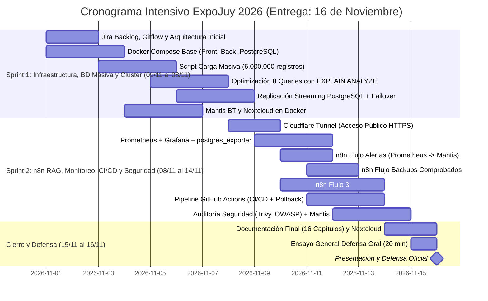

# Plan Integral de Trabajo - Práctica Integradora Final 2026
## Proyecto: ExpoJuy 2026 con Automatización n8n & RAG

---

## 1. Diagnóstico del Estado Actual del Proyecto

A partir de la inspección del repositorio actual (`back/expoJuy2026v2-Back` y `vmequieromatar/expojuy_2026`), se identificó el siguiente estado de partida:

### 1.1 Backend (`expoJuy2026v2-Back`)
* **Tecnología**: Node.js con Express 5.
* **ORM & Base de Datos**: Sequelize 6 conectado a PostgreSQL (`pg`, `pg-hstore`).
* **Modelos existentes**: `Stand`, `UbicacionStand`, `Expositor`, `Noticia`, `Galeria`, `Agenda`, `Eje`, `Correo`, `Usuario`, `Media`, `ReunionB2B`, `AuditoriaAccion`, `HistorialAcceso`.
* **Seguridad y utilidades existentes**: `bcryptjs`, `jsonwebtoken` (JWT), `cors`, `compression`, `express-rate-limit`, `multer` / `sharp` (imágenes), `nodemailer`, documentación con `swagger-autogen` / `swagger-ui-express`.
* **Chatbot actual**: Controlador `chatbot.controller.js` y servicio `chatbot-search.service.js` basados en coincidencia heurística de palabras clave (`extraerPalabrasClave`, `detectarIntencion`, `detectarSeccion`, `buscarEnBase`). Respuestas preprogramadas estáticas o búsquedas directas con Sequelize `Op.iLike`.
* **Estado de Infraestructura**: **No contenerizado**. No posee `Dockerfile` ni `docker-compose.yml`. Las pruebas unitarias están configuradas con Jest pero con cobertura mínima.

### 1.2 Frontend (`vmequieromatar/expojuy_2026`)
* **Tecnología**: Angular 17/18/19 (Standalone components, TypeScript, RxJS).
* **Módulos/Páginas**: Inicio, Expositores, Stands (con mapa/ubicaciones), Agenda, Noticias, Galería, B2B, Chatbot flotante interactivo.
* **Componente Chatbot**: `ChatbotComponent` y `ChatbotService` comunicándose con `POST /api/chatbot/query` y `GET /api/chatbot/search`. Posee debounce de 300 ms, sugerencias rápidas y renderizado de respuestas.
* **Estado de Infraestructura**: **No contenerizado**. No posee `Dockerfile` multi-stage ni configuración Nginx para producción.

---

## 2. Análisis de la Propuesta: Reemplazar el Bot por n8n + RAG

### 2.1 Viabilidad Técnica y Alineación con la Cátedra
La propuesta de reemplazar el bot basado en palabras clave por un **Asistente RAG (Retrieval-Augmented Generation)** orquestado en **n8n** es **100% viable, moderna y de alto impacto**, pero debe ejecutarse con una estrategia clara para **cumplir estrictamente con la consigna de la cátedra**:

> [!IMPORTANT]
> **Atención al Punto 13 del PDF**: La cátedra exige como mínimo **3 flujos funcionales en n8n** orientados a operaciones/DevOps:
> 1. **Alertas de infraestructura**: Prometheus Alertmanager $\rightarrow$ Webhook n8n $\rightarrow$ Crea incidencia en Mantis/GLPI $\rightarrow$ Notifica por Telegram/Discord/Slack.
> 2. **Verificación de backups**: Ejecución/verificación de dump PostgreSQL $\rightarrow$ Test de integridad $\rightarrow$ Registro de estado y alerta si falla.
> 3. **Flujo asistido por IA o Seguridad**: El PDF sugiere informe de rendimiento asistido por IA o clasificación de incidentes.
> 
> **Estrategia recomendada**: El **Chatbot RAG de ExpoJuy será el Flujo 3 (o Flujo 4 plus)**. Esto cumple con creces el requerimiento de IA y automatización del TP, conectando directamente el negocio de la aplicación con la infraestructura.

### 2.2 Arquitectura Técnica del Bot RAG en n8n
```
                    [ Usuario en Angular Frontend ]
                                   │
                                   ▼ (HTTP POST /api/chatbot/query)
                    [ Backend Node.js / Express ]
                                   │ (Proxy seguro con API Key)
                                   ▼ (Webhook POST)
                            [ n8n Workflow ]
 ┌─────────────────────────────────┴─────────────────────────────────┐
 │  1. AI Agent Node (LangChain en n8n)                              │
 │  2. Memory Buffer (Historial de conversación de la sesión)        │
 │  3. Vector Store Retriever:                                       │
 │     - PostgreSQL con extensión pgvector (o Qdrant / Supabase)     │
 │     - Embeddings de los datos de ExpoJuy:                         │
 │       * Stands, expositores, cronograma de conferencias           │
 │       * Preguntas frecuentes (accesos, horarios, entradas, B2B)   │
 │  4. LLM Model (OpenAI gpt-4o-mini / Google Gemini 1.5 Flash)      │
 │  5. Guardrails / Sanitización de salida                           │
 └─────────────────────────────────┬─────────────────────────────────┘
                                   │
                                   ▼ (JSON: { mensaje, sugerencias, referencias })
                    [ Frontend renderiza en el widget ]
```

**Ventajas de esta solución:**
1. **Sin modificar el contrato del Frontend**: El frontend sigue enviando `{ query: "..." }` y esperando `{ mensaje: "..." }`.
2. **Seguridad y Control de Costos**: Las API Keys del LLM quedan seguras dentro de las credenciales de n8n; no viajan al cliente. El backend actúa como rate-limiter para prevenir abuso.
3. **Calidad de Respuesta**: El bot ya no se limita a palabras clave exactas; entiende sinónimos, contexto coloquial jujeño, intenciones complejas ("¿dónde puedo ver stands sobre energía solar y a qué hora es la charla de litio?").

---

## 3. Matriz Gap Analysis: Qué Falta Hacer Según el Trabajo Práctico

| Sección del TP | Requerimiento de la Cátedra | Estado en ExpoJuy | Tarea Puntual Pendiente |
| :--- | :--- | :---: | :--- |
| **1. Diagnóstico** | Stack, arquitectura inicial, componentes a contenerizar, Git público | ⚠️ 40% | Documentar arquitectura actual, diagrama de componentes y modelo de datos. |
| **2. Scrum** | Jira, Product Backlog, Sprints, Criterios de Aceptación, Burndown | ❌ 0% | Crear proyecto en Jira/GitHub Projects, cargar user stories técnicas y de negocio. |
| **3. Git & Calidad** | Estrategia Gitflow (`main`, `develop`, `feature/*`), PRs, branch protection | ⚠️ 30% | Proteger `main`, configurar PRs con revisores requeridos, commits convencionales. |
| **4. Contenerización BD & Dataset Masivo** | Docker PostgreSQL, pgAdmin, volúmenes, backups, **6.000.000 de registros por tabla** | ❌ 0% | Crear `compose.yaml`, script generador masivo en Node/Python con bulk insert, `pgBadger`. |
| **5. Optimización SQL** | EXPLAIN / EXPLAIN ANALYZE, optimizar 8 consultas con 6M filas, índices, evitar no-SARG | ❌ 0% | Diseñar 8 queries pesadas (stands, historial, auditoría), crear índices compuestos/cobertura, comparar métricas antes/después. |
| **6. Clúster & Replicación** | Replicación Streaming Primary/Replica en PostgreSQL, lectura en réplica, simulación failover | ❌ 0% | Configurar réplica en Docker Compose, configurar pool de lectura en Sequelize, documentar failover. |
| **7. Contenerización Web** | Dockerfile Frontend (Nginx), Dockerfile Backend (Node alpine), redes Docker unificadas | ❌ 0% | Escribir Dockerfiles multi-stage, armar `docker-compose.yml` completo del sistema. |
| **8. CI/CD** | GitHub Actions / GitLab CI, lint, test, build docker, deploy automático, rollback | ❌ 0% | Crear `.github/workflows/ci-cd.yml`, secrets seguros, simular commit con falla y rollback. |
| **9. Publicación a Internet** | Servidor con túnel seguro (Cloudflare Tunnel), HTTPS, no exponer DB ni pgAdmin | ❌ 0% | Configurar `cloudflared` en Docker para exponer Front y API con dominio y SSL gratuito. |
| **10. Monitoreo** | Prometheus + Grafana, cAdvisor, postgres_exporter, dashboards, alertas probadas | ❌ 0% | Desplegar stack de observabilidad en Docker, dashboard con métricas reales y prueba de estrés. |
| **11. Incidencias** | Mantis Bug Tracker o GLPI en Docker, registrar 10 incidencias reales (rendimiento y seguridad) | ❌ 0% | Desplegar Mantis, documentar y cerrar 10 bugs con links a commits. |
| **12. Nextcloud** | Nextcloud en Docker, carpetas, permisos, repositorio de evidencias y entregables | ❌ 0% | Desplegar Nextcloud, organizar árbol documental y permisos por rol. |
| **13. n8n Automatización** | n8n en Docker, credenciales protegidas, 3 flujos mínimos (Alertas, Backups, IA/RAG) | ❌ 0% | Desplegar n8n, crear Flujo Alertas (Prometheus $\rightarrow$ Mantis), Flujo Backup, y Flujo RAG Chatbot. |
| **14. Ciberseguridad** | Matriz amenazas STRIDE/OWASP, escaneo Trivy/OWASP ZAP, inyección SQL, hard-coded secrets | ⚠️ 20% | Auditoría de vulnerabilidades con Trivy/Snyk, informe de remediaciones y políticas de seguridad. |
| **15. Documentación & Defensa** | 16 capítulos obligatorios, manuales, evidencias, presentación de 20 min | ❌ 0% | Redactar informe maestro unificado en Markdown/PDF y diapositivas de defensa. |

---

## 4. División de Roles y Asignación para 5 Integrantes

Para que el equipo avance en paralelo sin bloquearse entre sí, se asignan roles según las áreas de especialización requeridas por el TP:

### 👤 Integrante 1: DevOps & Arquitectura de Contenedores (Líder de Infraestructura)
* **Responsabilidades Clave:**
  * Dockerfiles de Backend (Node multi-stage) y Frontend (Angular build + Nginx Alpine).
  * Orquestación general en `docker-compose.yml` (redes internas aisladas: `frontend-net`, `backend-net`, `db-net`).
  * Implementación de **Cloudflare Tunnel (`cloudflared`)** para acceso HTTPS seguro desde Internet sin abrir puertos en el router (Punto 9).
  * Control de variables de entorno `.env` seguras y sin exposición de secretos.
* **Entregables:**
  * Archivos `Dockerfile`, `.dockerignore`, `compose.yaml`.
  * Diagrama de red y arquitectura de despliegue.
  * Acceso público funcional verificado vía dominio/túnel Cloudflare.

### 👤 Integrante 2: DBA & Rendimiento de Base de Datos (Especialista en Datos)
* **Responsabilidades Clave:**
  * Configuración de **PostgreSQL con Replicación Streaming (Primary / Standby Replica)** en Docker (Punto 6).
  * Creación del **Dataset Masivo de al menos 6.000.000 de registros** (Punto 4):
    * *Recomendación práctica*: Crear una tabla de auditoría, logs de visitas a stands o métricas B2B donde generar 6M de filas con un script optimizado de Node/Python usando transacciones por lotes (`COPY` o batches de 50.000 inserts) para que tarde menos de 3-5 minutos.
  * Medición y optimización de **8 consultas SQL** usando `EXPLAIN ANALYZE` (Punto 5).
  * Configuración de índices (B-Tree, compuestos, índices parciales) y solución de queries no SARGables.
  * Estrategia y scripts de Backup (`pg_dump`) y restauración comprobada.
* **Entregables:**
  * Scripts de carga masiva y evidencias de volumen (tamaño en MB/GB y tiempos de carga).
  * Informe técnico de optimización SQL con tablas comparativas antes/después (tiempos de ejecución y costos del planner).
  * Evidencias de replicación y prueba de failover.

### 👤 Integrante 3: CI/CD & Observabilidad (Especialista en Automatización & Monitoreo)
* **Responsabilidades Clave:**
  * Configuración del pipeline de **GitHub Actions** (Punto 8):
    * Etapa 1: Linting y tests automatizados de backend y frontend.
    * Etapa 2: Construcción de imágenes Docker y escaneo básico de seguridad.
    * Etapa 3: Despliegue automático y prueba de rollback ante fallos.
  * Despliegue y configuración del stack de monitoreo: **Prometheus + Grafana** (Punto 10).
  * Configuración de exportadores: `cAdvisor` (contenedores), `node-exporter` (host), `postgres_exporter` (PostgreSQL).
  * Creación del Dashboard en Grafana (CPU, RAM, red, queries lentas, replicación).
  * Configuración de alertas en Prometheus/Alertmanager (disparador para el webhook de n8n).
* **Entregables:**
  * Workflow `.github/workflows/ci-cd.yml` funcional con evidencias de ejecuciones y rollback.
  * Dashboard de Grafana importable (JSON) con gráficos de métricas reales y alertas testeadas.

### 👤 Integrante 4: Automatización de Procesos con n8n & Asistente RAG (Especialista en IA & Workflows)
* **Responsabilidades Clave:**
  * Despliegue de **n8n** en Docker con almacenamiento persistente y credenciales seguras (Punto 13).
  * **Flujo 1 (DevOps)**: Prometheus Alertmanager $\rightarrow$ n8n Webhook $\rightarrow$ Crear ticket automático en Mantis/GLPI $\rightarrow$ Notificar por bot de Telegram al equipo.
  * **Flujo 2 (DevOps)**: Ejecución y verificación periódica de Backups de base de datos con test de restauración y alerta de error.
  * **Flujo 3 (Core - RAG ExpoJuy)**:
    * Vectorización de los datos de ExpoJuy (stands, expositores, cronograma, FAQs).
    * Workflow de n8n con nodo LangChain AI Agent + Vector Store (pgvector o base vectorial liviana) + modelo LLM (Gemini/OpenAI).
    * Integración con el Backend/Frontend de ExpoJuy para sustituir el bot viejo por el nuevo motor RAG inteligente.
* **Entregables:**
  * Exportación de los 3 flujos de n8n (archivos JSON de workflows).
  * Evidencias de ejecuciones exitosas y manejo de errores.
  * Demostración en vivo del Chatbot RAG respondiendo en la web de ExpoJuy.

### 👤 Integrante 5: Calidad, Seguridad, Gestión & Documentación (Scrum Master & QA/Sec)
* **Responsabilidades Clave:**
  * Gestión ágil del proyecto en **Jira** (Punto 2): Backlog, Sprints, historias de usuario con criterios de aceptación, control de avance y burndown.
  * Configuración de la estrategia Gitflow, protección de ramas y plantillas de Pull Request (Punto 3).
  * Despliegue y administración de **Mantis Bug Tracker o GLPI** en Docker (Punto 11): Registrar 10 incidencias reales/reproducibles vinculadas a commits de Git.
  * Despliegue de **Nextcloud** en Docker (Punto 12) para centralizar la documentación y matriz de permisos.
  * **Ciberseguridad y Amenazas Actuales** (Punto 14):
    * Escaneo de vulnerabilidades con Trivy / Snyk / OWASP ZAP.
    * Elaboración de la Matriz de Amenazas (STRIDE / OWASP Top 10) y plan de respuesta a incidentes.
  * Coordinación y redacción final del documento maestro con los **16 puntos obligatorios** y armado de la presentación de 20 minutos (Punto 15).
* **Entregables:**
  * Tablero Jira con evidencias de Sprints y métricas.
  * Mantis con 10 incidencias cerradas y trazadas.
  * Informe de Seguridad y Matriz de Riesgos.
  * Documento Técnico Final (PDF/Markdown de 16 capítulos) y diapositivas de la defensa.

---

## 5. Estimación de Tiempos y Cronograma de Sprints (Entrega: 16 de Noviembre)

Teniendo en cuenta la fecha límite ineludible fijada por la cátedra (**semana del 16 de noviembre de 2026**) y arrancando el **1 de noviembre de 2026**, el equipo cuenta con una ventana estricta de **15 días corridos** (aprox. 15 a 18 horas semanales por integrante, totalizando ~150 a 170 horas-hombre entre los 5 integrantes).

Para cumplir rigurosamente con Scrum en este plazo acotado, la estrategia óptima es dividir el proyecto en **2 Sprints intensivos de 7 días** más **1 día de congelamiento y preparación de defensa**:



---

### Detalle de los Sprints:

#### 🟢 Sprint 1: Cimientos de Infraestructura, Datos Masivos y Replicación (01/11 al 08/11)
* **Objetivo del Sprint**: Tener la infraestructura base corriendo en contenedores, la base de datos poblada con 6M de registros, optimizada y replicada.
* **Entregables al finalizar la Semana 1**:
  * **Día 1-2 (01-02 Nov)**: Jira configurado con historias de usuario, repositorio Git con ramas protegidas (`main`, `develop`), `compose.yaml` levantando Frontend (Angular/Nginx), Backend (Express) y PostgreSQL con pgAdmin.
  * **Día 3-4 (03-04 Nov)**: Despliegue de herramientas soporte (Mantis BT y Nextcloud). Script masivo ejecutado: tabla con **6.000.000 registros** generada en menos de 5 min con métricas documentadas (tamaño, tiempo de carga).
  * **Día 5-6 (05-06 Nov)**: Medición y optimización de **8 consultas pesadas con `EXPLAIN ANALYZE`** (Sequential Scans eliminados con índices B-Tree/compuestos, corrección de no-SARGables).
  * **Día 7-8 (07-08 Nov)**: Clúster de **replicación PostgreSQL (Primary/Replica)** funcionando en Docker, lectura balanceada o conectada a réplica y simulación de failover documentada. Sprint Review y Retrospectiva 1.

#### 🔵 Sprint 2: Automatización n8n, Chatbot RAG, Observabilidad y Seguridad (08/11 al 14/11)
* **Objetivo del Sprint**: Automatizar flujos de DevOps, conectar el asistente inteligente RAG a la web, monitorear la plataforma y endurecer la seguridad.
* **Entregables al finalizar la Semana 2**:
  * **Día 8-9 (08-09 Nov)**: Publicación segura con **Cloudflare Tunnel (`cloudflared`)** verificando acceso HTTPS externo desde celulares/redes móviles sin abrir puertos.
  * **Día 9-11 (09-11 Nov)**: Stack de observabilidad **Prometheus + Grafana** con métricas en tiempo real (`postgres_exporter`, `cadvisor`) y alertas activas. Pipeline **CI/CD en GitHub Actions** con test, build de imágenes Docker y prueba de rollback documentada.
  * **Día 10-13 (10-13 Nov)**: **n8n en Docker con sus 3 flujos obligatorios**:
    1. *Alerta*: Prometheus dispara webhook $\rightarrow$ n8n abre ticket en Mantis $\rightarrow$ Notifica por Telegram al equipo.
    2. *Backups*: Dump automático comprobado con test de restauración.
    3. *Asistente RAG ExpoJuy*: Webhook n8n con nodo AI Agent + Vector Store (datos reales de la Expo: cronograma, stands, FAQs) respondiendo en vivo dentro del widget de chat de la web.
  * **Día 12-14 (12-14 Nov)**: Cierre de **10 incidencias reales en Mantis** vinculadas a commits de Git. Escaneo de vulnerabilidades con Trivy/OWASP y matriz de amenazas completada. Sprint Review y Retrospectiva 2.

#### 🔴 Cierre, Ensayo y Presentación Final (15/11 al 16/11)
* **15 de Noviembre (Día de Congelamiento y Ensayo)**:
  * Consolidar el **documento técnico final con los 16 capítulos obligatorios** y subirlo a Nextcloud con su estructura de permisos.
  * Verificar que la URL de Cloudflare Tunnel esté operativa para la demo en vivo.
  * **Simulacro cronometrado de la defensa oral (20 minutos)**: 4 minutos por integrante explicando cada uno su área técnica con evidencias en vivo, resolviendo posibles preguntas de la cátedra.
* **16 de Noviembre (Día D)**:
  * Presentación y defensa oral del proyecto ante la cátedra.

---

## 6. Guía Técnica de Implementación para los Desafíos Críticos

### 6.1 Cómo generar los 6.000.000 de registros eficientemente
Para evitar que la carga tarde horas:
1. Crear una tabla de auditoría de interacciones o visitas a stands:
   ```sql
   CREATE TABLE visitas_stands (
       id BIGSERIAL PRIMARY KEY,
       stand_id INTEGER NOT NULL,
       fecha_visita TIMESTAMP NOT NULL,
       dispositivo VARCHAR(50),
       tiempo_permanencia_seg INTEGER,
       calificacion INTEGER
   );
   ```
2. Usar un script en Node.js o Python que inserte bloques de 20.000 a 50.000 registros mediante transacciones o generando un archivo CSV y ejecutando `\copy visitas_stands FROM 'data.csv' WITH CSV`.
3. Esto permite cargar los 6.000.000 de registros en menos de **3 a 5 minutos**, dejando la tabla lista para las pruebas de `EXPLAIN ANALYZE` y consultas no SARGables.

### 6.2 Cómo estructurar el Docker Compose Global
Recomendación para no saturar los recursos de una sola máquina:
* **Archivo 1 (`compose.yaml`)**: Núcleo de la aplicación (`frontend`, `backend`, `postgres-primary`, `postgres-replica`, `pgadmin`, `cloudflared`).
* **Archivo 2 (`compose-monitoring.yaml`)**: Observabilidad y automatización (`prometheus`, `grafana`, `cadvisor`, `postgres_exporter`, `n8n`).
* **Archivo 3 (`compose-tools.yaml`)**: Soporte (`mantis`, `nextcloud`).
* Comparten una misma red Docker bridge (`docker network create red-expojuy`).

### 6.3 Publicación Gratuita y Segura con Cloudflare Tunnel
Evita abrir puertos en el módem hogareño y saltarse bloqueos de CGNAT de los ISPs:
```yaml
  cloudflared:
    image: cloudflare/cloudflared:latest
    container_name: expojuy-tunnel
    restart: unless-stopped
    command: tunnel run
    environment:
      - TUNNEL_TOKEN=${CLOUDFLARE_TUNNEL_TOKEN}
    networks:
      - red-expojuy
```
Permite exponer `https://expojuy.tudominio.com` con certificado TLS gestionado automáticamente.

---

## 7. Próximos Pasos Inmediatos Recomendados

1. **Reunión de kickoff de los 5 integrantes**: Presentar este plan, validar los roles y crear el proyecto en Jira.
2. **Crear el repositorio organizador en GitHub**: Con ramas protegidas y estructura inicial.
3. **Comenzar con el Docker Compose base** de la base de datos y la aplicación (Punto 4 y 7) para que todos los integrantes trabajen sobre el mismo entorno dockerizado desde el día uno.

