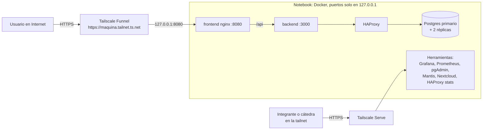

# Publicación y acceso desde Internet (punto 9)

Cómo se publica ExpoJuy 2026 desde una notebook local, quién puede acceder a cada servicio y
con qué controles. Responsable: Integrante 1.

## 1. Resumen

| Nivel | Mecanismo | Quién accede | Servicios |
|---|---|---|---|
| **Público** | Tailscale **Funnel** | Cualquiera en Internet | La aplicación web (frontend + API en `/api`) |
| **Restringido** | Tailscale **Serve** | Solo los miembros de la tailnet (equipo y cátedra invitados) | Interfaces administrativas |
| **Local** | Ninguno | Solo la notebook | Base de datos y servicios internos del clúster |

Regla: la aplicación es pública, lo administrativo es privado y la base de datos no se publica.

## 2. Conceptos

| Término | Qué es |
|---|---|
| **Tailscale** | VPN que une dispositivos en una red privada cifrada (WireGuard), estén donde estén |
| **Tailnet** | La red privada de Tailscale: los dispositivos y las personas invitadas |
| **Funnel** | Publica un servicio local en Internet con HTTPS, a través de los servidores de Tailscale |
| **Serve** | Publica un servicio local con HTTPS solo dentro de la tailnet |
| **Túnel** | Conexión que **sale** de la notebook hacia Tailscale. Por eso no hace falta abrir puertos de entrada en el router ni en el firewall |

## 3. Diagrama de red



## 4. Servicio por servicio

| Servicio | Puerto local | Nivel | Autenticación |
|---|---|---|---|
| Web (frontend + `/api`) | 8080 | **Funnel** | Pública; el panel `/admin` pide login |
| Mantis | 8082 | **Serve** | Usuario de Mantis |
| Nextcloud | 8083 | **Serve** | Usuario de Nextcloud |
| Grafana | 3001 | **Serve** | `GF_SECURITY_ADMIN_*` |
| Prometheus | 9090 | **Serve** | Sin login propio: lo protege la tailnet |
| pgAdmin | 5050 | **Serve** | `PGADMIN_*` |
| HAProxy stats | 8404 | **Serve** | `HA_PROXY_STATS_*` |
| Sentinel (API de estado) | 8008 | Local | — |
| Postgres primario / réplicas | 5433 / 5434, 5435 | Local | — |
| HAProxy escritura / lectura | 5437 / 5438 | Local | — |

Credenciales: ver `infra/.env`.

## 5. Configuración

### 5.1 Docker: todo en `127.0.0.1`
Los compose publican los puertos como `"127.0.0.1:PUERTO:PUERTO"`: solo responden en la propia
notebook, no en la red local. Tailscale los toma desde ahí. Comprobación:

```powershell
docker ps --format "table {{.Names}}\t{{.Ports}}"
```

Excepción pendiente: el frontend está en `0.0.0.0:8080` (accesible desde la red local).

### 5.2 Funnel (aplicación pública)

```powershell
tailscale funnel status
```

Resultado esperado: `https://<maquina>.<tailnet>.ts.net (Funnel on)` con `/ proxy http://127.0.0.1:8080`.

El backend tiene que conocer su URL pública (CORS y enlaces de los correos). En `infra/.env`:

```
PUBLIC_URL=https://<maquina>.<tailnet>.ts.net
```

Después se recrea el backend (`up -d` con todos los `-f`, ver `OPERACION_CAMBIOS.md`).

### 5.3 Serve (herramientas restringidas)
Paso a paso, en forma manual o con el script `infra/scripts/tailscale-publicar.ps1`:
[`PUBLICAR_HERRAMIENTAS.md`](PUBLICAR_HERRAMIENTAS.md).

Cada herramienta usa **su propio puerto**, nunca el 443. Funnel se habilita por puerto: una ruta
agregada al 443 quedaría pública junto con la aplicación.

```powershell
tailscale serve --bg --https=8082 http://127.0.0.1:8082   # Mantis
tailscale serve --bg --https=8083 http://127.0.0.1:8083   # Nextcloud
tailscale serve --bg --https=3001 http://127.0.0.1:3001   # Grafana
tailscale serve --bg --https=9090 http://127.0.0.1:9090   # Prometheus
tailscale serve --bg --https=5050 http://127.0.0.1:5050   # pgAdmin
tailscale serve --bg --https=8404 http://127.0.0.1:8404   # HAProxy stats
tailscale serve status
```

Ajustes que necesitan las aplicaciones para responder con la nueva dirección:

| Aplicación | Ajuste |
|---|---|
| Nextcloud | Agregar el dominio `.ts.net` a `trusted_domains` y el gateway de Docker a `trusted_proxies` |
| Mantis | `$g_path` en `config/config_inc.php` fijo en `http://127.0.0.1:8082/`: cambiarlo a la URL de Serve |

Comandos en [`PUBLICAR_HERRAMIENTAS.md`](PUBLICAR_HERRAMIENTAS.md).

### 5.4 Quién puede acceder
- **Equipo:** invitación a la tailnet (consola de Tailscale → *Users* → *Invite*).
- **Cátedra:** compartir la máquina (consola → *Machines* → *Share*). Ve solo esta máquina, no el resto de la tailnet.

## 6. Firewall y HTTPS

| Control | Cómo se cumple |
|---|---|
| Puertos de entrada | **Ninguno abierto** en el router ni en el firewall de Windows: el túnel es saliente |
| HTTPS | Tailscale emite y renueva el certificado de `*.ts.net` (Funnel y Serve) |
| Base de datos | No se publica: puertos solo en `127.0.0.1` y fuera de Funnel/Serve |
| Administración | Solo por Serve (tailnet) y con login propio de cada herramienta |

## 7. Disponibilidad y errores

- La aplicación está disponible mientras la notebook esté encendida, con Docker y Tailscale activos.
- Medición: panel de disponibilidad en Grafana con `up` (cada servicio medido) y `pg_up` (cada nodo de Postgres). Pendiente de agregar al dashboard.
- Errores: `docker logs <contenedor>` y las alertas de Prometheus (`/alerts`).
- Chequeo rápido: `infra/scripts/check-servicios.ps1`.

## 8. Riesgos y limitaciones

| Riesgo | Impacto | Mitigación |
|---|---|---|
| Una sola máquina | Si se apaga o se cuelga, todo cae | Arranque automático (`restart: unless-stopped`) y backups diarios |
| Dependencia de Tailscale | Sin el servicio de Tailscale no hay acceso externo | Alternativa documentable: Cloudflare Tunnel |
| `/api-docs` (Swagger) público | Expone la descripción de la API | Restringirlo en producción (punto 14) |
| `/admin/login` público | Ataques de fuerza bruta | Claves fuertes; limitar intentos (punto 14) |
| Frontend en `0.0.0.0` | Accesible desde la red local | Pasarlo a `127.0.0.1` |
| Ancho de banda doméstico | Rendimiento limitado | Aceptado para la demostración |

## 9. Evidencias

- [ ] Captura de `tailscale funnel status`.
- [ ] Acceso desde un celular con datos móviles (fuera de la red local) a la web y a `/api/health`.
- [ ] Captura de `tailscale serve status`.
- [ ] Acceso a una herramienta desde otro dispositivo de la tailnet, y rechazo desde fuera.
- [ ] `docker ps` mostrando los puertos en `127.0.0.1`.

## 10. Estado

| Ítem | Estado |
|---|---|
| Funnel `/` → `127.0.0.1:8080` | Verificado (13 al 15/11/2026) |
| `PUBLIC_URL` con https | Pendiente |
| Serve para las 6 herramientas ("tailnet only") | Verificado 15/11/2026 desde la notebook |
| Ajustes de Nextcloud y Mantis | Verificado 15/11/2026 |
| Acceso desde otro dispositivo de la tailnet y rechazo desde fuera | Pendiente |
| Frontend en `127.0.0.1` | Pendiente |
| Panel de disponibilidad | Pendiente |
| Evidencia de acceso externo | Pendiente |
