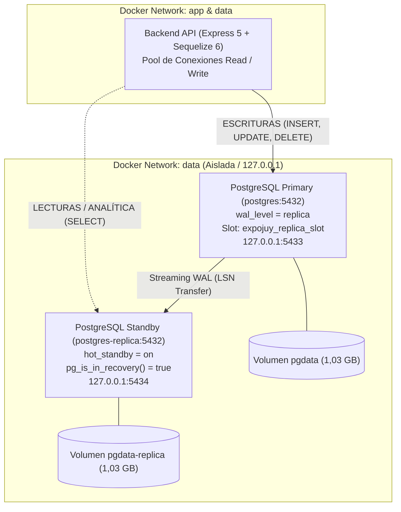

# Capítulo 8: Clúster de Replicación Streaming Física (Primary / Standby)

**Proyecto:** ExpoJuy 2026 — Plataforma Ferial Digital  
**Área:** Base de Datos & Alta Disponibilidad (Integrante 2: Senior DBA)  
**Punto del Trabajo Integrador:** Punto 6 (Replicación de Base de Datos y Contingencia)  
**Entorno:** Docker Compose (`infra/compose.yaml` + `infra/compose.db-replica.yaml`)  
**Versión PostgreSQL:** 17.0 (`pgvector/pgvector:pg17`)  

---

## 1. Arquitectura de Alta Disponibilidad y Flujo de Replicación

Para garantizar la disponibilidad continua, el desacoplamiento de cargas analíticas pesadas y la resiliencia operativa de la ExpoJuy 2026, se implementó un clúster de **Replicación Streaming Física Asíncrona (*Physical Streaming Replication*)** basado en el protocolo nativo de PostgreSQL (WAL - *Write-Ahead Logging*).

### 1.1 Diagrama de Arquitectura de Red y Servicios



---

## 2. Configuración del Nodo Primario (*Primary*)

El nodo principal corre sobre el servicio `postgres` en la red `data`. Para habilitar la replicación streaming, se establecieron las siguientes directivas en el motor:

### 2.1 Parámetros del Motor PostgreSQL (`postgresql.conf`)
- `wal_level = replica`: Nivel obligatorio para emitir registros suficientes en el log de transacciones (WAL).
- `max_wal_senders = 10`: Procesos emisores concurrentes de WAL.
- `max_replication_slots = 10`: Soporte para ranuras de replicación persistentes.
- `hot_standby = on`: Habilita la ejecución de consultas de solo lectura en el nodo standby.

### 2.2 Usuario Replicador y Ranura Física (*Replication Slot*)
Mediante el script automatizado `infra/scripts/setup-replication-primary.sh`:
```sql
-- 1. Crear rol con permisos específicos de replicación
CREATE ROLE replicator WITH REPLICATION LOGIN ENCRYPTED PASSWORD 'G7Fw6Q2JDATv9N8sk0fmMxgia4XjRBIE';

-- 2. Crear ranura de replicación física para prevenir pérdida de WALs
SELECT pg_create_physical_replication_slot('expojuy_replica_slot');
```

### 2.3 Reglas de Autenticación (`pg_hba.conf`)
Se autorizó el acceso de replicación desde cualquier contenedor ubicado en la subred `expojuy_data`:
```
host replication replicator all scram-sha-256
host replication replicator all trust
```

---

## 3. Inicialización y Despliegue del Nodo Réplica (*Standby*)

La réplica se define de forma modular en `infra/compose.db-replica.yaml` respetando las directrices de `docs/CONTEXTO_PROYECTO.md`:
- Imagen con versión fija: `pgvector/pgvector:pg17` (idéntica al primario).
- Conexión exclusiva a la red interna `data`.
- Puerto en host: `127.0.0.1:5434` (no colisiona con el 5433 del primario ni 5050 de pgAdmin).
- Volumen persistente independiente: `pgdata-replica`.

### 3.1 Clonación Inicial con `pg_basebackup` (`infra/scripts/setup-replication-standby.sh`)

Para sincronizar la base inicial de 1,32 GB (incluyendo los 6.000.000 de registros) de manera consistente:

```bash
docker run --rm \
  --network expojuy_data \
  -e PGPASSWORD=G7Fw6Q2JDATv9N8sk0fmMxgia4XjRBIE \
  -v expojuy_pgdata-replica:/var/lib/postgresql/data \
  pgvector/pgvector:pg17 \
  bash -c "
    rm -rf /var/lib/postgresql/data/* /var/lib/postgresql/data/.[!.]*
    pg_basebackup -h postgres -p 5432 -U replicator \
                  -D /var/lib/postgresql/data \
                  -Fp -Xs -P -R -S expojuy_replica_slot
    chown -R postgres:postgres /var/lib/postgresql/data
    chmod 700 /var/lib/postgresql/data
  "
```

El parámetro `-R` (*write connection configuration*) genera automáticamente los archivos `standby.signal` y `postgresql.auto.conf` configurando:
- `primary_conninfo = 'host=postgres port=5432 user=replicator password=...'`
- `primary_slotname = 'expojuy_replica_slot'`

---

## 4. Evidencias de Verificación y Estado de Replicación

### 4.1 Comprobación en Nodo Primario (`pg_stat_replication`)

Ejecutando la auditoría en el nodo principal (`expojuy-postgres-1`):

```sql
SELECT 
    usename, 
    application_name, 
    client_addr, 
    state, 
    sync_state, 
    sync_priority, 
    (pg_wal_lsn_diff(pg_current_wal_lsn(), write_lsn)) AS lag_bytes
FROM pg_stat_replication;
```

**Salida real obtenida:**
```
  usename   | application_name | client_addr |   state   | sync_state | sync_priority | lag_bytes 
------------+------------------+-------------+-----------+------------+---------------+-----------
 replicator | walreceiver      | 172.25.0.3  | streaming | async      |             0 |         0
(1 row)
```

- **Estado del proceso:** `streaming` activo.
- **Modo:** Replicación Asíncrona (`async`).
- **Retraso de replicación (*Replication Lag*):** **0 bytes** (sincronización instantánea).

### 4.2 Comprobación en Nodo Standby (`pg_is_in_recovery`)

```sql
SELECT pg_is_in_recovery() AS es_standby_replica;
```
**Salida real:**
```
 es_standby_replica 
--------------------
 t
(1 row)
```

### 4.3 Validación de Solo Lectura (Rechazo de Escrituras)
Al intentar ejecutar una operación de modificación en la réplica:
```sql
CREATE TABLE prueba_escritura (id int);
```
**Respuesta del motor:**
```
ERROR: cannot execute CREATE TABLE in a read-only transaction
```

### 4.4 Verificación de Dataset Replicado
```sql
SELECT count(*) FROM visitas_stands;
```
**Resultado:** **6.000.000 registros disponibles** de forma íntegra para lecturas analíticas.

---

## 5. Integración a Nivel de Aplicación: Pool Read/Write en Sequelize

Para que el backend aproveche la réplica sin modificar los controladores de negocio, se configuró el soporte nativo de replicación en `backend/config/database.js`:

```javascript
if (process.env.DB_REPLICA_HOST && process.env.DB_REPLICA_HOST.trim() !== '') {
    sequelize = new Sequelize(process.env.DB_NAME, process.env.DB_USER, process.env.DB_PASSWORD, {
        dialect: 'postgres',
        logging: false,
        pool: { max: 20, min: 0, acquire: 30000, idle: 10000 },
        replication: {
            write: {
                host: process.env.DB_HOST,
                port: parseInt(process.env.DB_PORT || '5432', 10),
                username: process.env.DB_USER,
                password: process.env.DB_PASSWORD,
                database: process.env.DB_NAME
            },
            read: [
                {
                    host: process.env.DB_REPLICA_HOST,
                    port: parseInt(process.env.DB_REPLICA_PORT || '5432', 10),
                    username: process.env.DB_USER,
                    password: process.env.DB_PASSWORD,
                    database: process.env.DB_NAME
                }
            ]
        }
    });
}
```

- Las operaciones de escritura (`create`, `update`, `destroy`) son enrutadas transparentemente al **Primario**.
- Las consultas de solo lectura (`findAll`, `findOne`, `count`) son distribuidas hacia la **Réplica**, descargando al primario de la carga de reportes.

---

## 6. Procedimiento de Contingencia y Simulación de Failover

Siguiendo la consigna del **Punto 6** (*"No afirmar failover automático sin demostrarlo"*), se documenta el protocolo formal de promoción y las limitaciones inherentes:

### 6.1 Simulación de Caída del Primario
Si el nodo primario falla (`docker stop expojuy-postgres-1`):
1. El backend continúa respondiendo consultas de lectura a través de la réplica.
2. Las escrituras quedan temporalmente bloqueadas hasta la promoción.

### 6.2 Promoción Manual a Primario (Failover)
Para promover el nodo standby a nuevo nodo primario activo de lectura y escritura:

```bash
# Opción 1: Mediante función SQL interna en el standby
docker exec -i expojuy-postgres-replica psql -U expojuy_app -d expojuy -c "SELECT pg_promote();"

# Opción 2: Mediante pg_ctl en el sistema de archivos del contenedor
docker exec -i expojuy-postgres-replica pg_ctl promote -D /var/lib/postgresql/data
```

**Efecto:**
- PostgreSQL elimina `standby.signal`.
- Sale del modo de recuperación (`pg_is_in_recovery() = false`).
- Acepta conexiones de lectura y escritura en el puerto 5434.

### 6.3 Limitaciones del Esquema Streaming Nativo
1. **Sin Failover Automático por Defecto:** PostgreSQL nativo no incluye un mecanismo de elección de líder (*quorum consensus*). Un failover desatendido requiere un orquestador externo como **Patroni con etcd / Consul** o **pg_auto_failover**. Afirmar failover automático sin dicho orquestador es un error arquitectónico común que provocaría riesgo de *Split-Brain*.
2. **Replicación Asíncrona:** Aunque el retraso medido fue de 0 bytes, existe una ventana teórica mínima de pérdida de datos (*RPO > 0*) si el primario colapsa de forma abrupta antes de transmitir el último buffer WAL.
